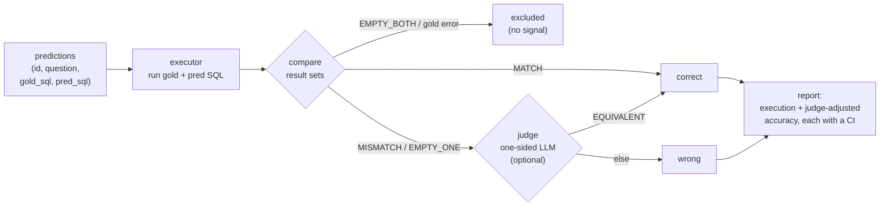

# plumbline

Executor-agnostic evaluation for text-to-SQL systems: **execution accuracy**, an
optional **FLEX-style LLM equivalence judge**, a **gold-set validation gate**, and
**routing accuracy** for the stage that picks which table answers the question.
Every rate comes with a **confidence interval**, not a bare point estimate.

A plumb line is the hanging weight that tells a builder whether a wall is true.
This tells you whether an answer is.

The core is pure Python stdlib (SQLite backend). Cloud backends (BigQuery, Gemini)
are optional extras. `make test` runs green from a fresh clone with no credentials.

## Quick start

```bash
make install   # uv venv + editable install with dev deps (no cloud extras)
make test      # fast suite, no cloud
make example   # build the demo DB, then print a score report and a gate report
make example-routing  # print a routing report, without and with catalog snapping
```

Against a real warehouse instead of the demo SQLite file, see
[`examples/bigquery_eval.py`](examples/bigquery_eval.py) — same comparator, gate
and intervals, with `BigQueryExecutor` swapped in for `SQLiteExecutor`:

```bash
uv pip install -e '.[bigquery]'
python examples/bigquery_eval.py --project my-project \
    --predictions preds.csv --gate-only   # audit the golds before spending
```

## What gets compared

Not SQL text — SQL *results*. Both the predicted and the gold query run against a
database, and the row sets are compared under SQL semantics: column-order
independent, multiset unless the gold has `ORDER BY`, float-tolerant to 4 decimals,
NULL-safe. Two queries written differently that return the same rows count as a
match. This is the Spider/BIRD "execution accuracy" metric.



The **gate** is separate and runs upstream: it audits the gold set itself (a broken
gold silently corrupts every score), flagging non-SELECT, empty/placeholder,
failing, zero-row, degenerate, truncated, and (opt-in) non-deterministic golds.

## Input format

Two CSVs, both keyed by `id`.

`predictions.csv` — for `score`:

```csv
id,question,gold_sql,pred_sql
p1,"names of engineering employees","SELECT name FROM employee WHERE dept_id = 1","SELECT e.name FROM employee e JOIN department d ON e.dept_id = d.id WHERE d.name = 'Engineering'"
```

`golds.csv` — for `gate`:

```csv
id,gold_sql
ok1,"SELECT name FROM employee"
bad_nonselect,"DELETE FROM employee"
```

## Output format

`score` prints both rates with confidence intervals and a per-question list:

```
execution accuracy: 0.400  95% CI [0.118, 0.769]  (2/5)
judge-adjusted:     0.400  95% CI [0.118, 0.769]  (2/5)
scored 5 of 6  (1 excluded)

per-question:
  p1  MATCH       correct
  p2  MATCH       correct
  p3  MISMATCH    wrong
  p4  MISMATCH    wrong
  p5  PRED_ERROR  wrong
  p6  EMPTY_BOTH  excluded
```

`gate` prints a defect tally and the flagged golds, and exits non-zero so it can
guard a CI step:

```
gate: 7 golds, 2 clean, 5 flagged
defects: DEGENERATE=1  EXEC_FAIL=1  NON_SELECT=1  PLACEHOLDER_COMMENT=1  ZERO_ROWS=1

flagged:
  bad_nonselect    NON_SELECT            not a read-only SELECT/WITH
  bad_execfail     EXEC_FAIL             execution failed: no such column: missing_column
  bad_degenerate   DEGENERATE            single trivial cell (NULL/0) — likely an empty aggregate
  ...
```

Both reads above are exactly what `make example` prints.

## Routing accuracy

In a warehouse with many tables, a text-to-SQL pipeline usually routes the
question to one table first, then writes SQL against it. A routing miss
guarantees a generation miss, so `score-routing` grades that stage on its own —
the report should say *which* stage failed. No database needed; it compares
table names.

Input, for `score-routing`:

```csv
id,question,gold_table,pred_table
r1,total order count by month?,sales.orders,sales.orders
r4,average order value?,sales.orders,sales.customers
```

Two rates: **dataset accuracy** (right dataset, i.e. the part before the dot)
and **table accuracy** (exact `dataset.table`). Empty predictions count as
misses, never exclusions. With `--catalog` (a file of valid table names, one
per line), a near-miss prediction snaps to the closest real name before
scoring, and the snapped count is always printed so the correction is never
invisible:

```
dataset accuracy: 0.833  95% CI [0.436, 0.970]  (5/6)
table accuracy:   0.667  95% CI [0.300, 0.903]  (4/6)
snapped 1 of 6 predictions to the catalog

per-question:
  r1  sales.orders                              correct
  r2  sales.customers                           correct
  r3  finance.invoices                          correct
  r4  sales.customers                           dataset only
  r5  inventory.stock_level -> inventory.stock_levels  snapped, correct
  r6  (empty)                                   wrong
```

This is the second read `make example-routing` prints; the first runs without
`--catalog`, where r5 stays a plain miss (3/6).

## Library use

```python
from plumbline.executor import SQLiteExecutor
from plumbline.harness import evaluate

executor = SQLiteExecutor("demo.db")
predictions = [("p1", "names?", "SELECT name FROM employee", "SELECT name FROM employee")]
report = evaluate(executor, predictions)          # judge_backend=... to enable the LLM judge
print(report.execution.point, report.execution.low, report.execution.high)
```

`SQLiteExecutor` is one implementation of the `Executor` protocol (`execute(sql) ->
ExecResult`). Swap in `BigQueryExecutor` (the `[bigquery]` extra) or any object with
the same method; nothing else changes.

## Optional extras

```bash
uv pip install -e ".[bigquery]"   # BigQueryExecutor
uv pip install -e ".[gemini]"     # gemini_backend for the judge
```

## Notebooks

Two runnable walkthroughs, both offline and free, both executed by the test
suite so they cannot rot:

- [`notebook/quickstart.ipynb`](notebook/quickstart.ipynb) — for a consumer:
  score, gate, and score-routing, step by step with the example data.
- [`notebook/internals.ipynb`](notebook/internals.ipynb) — for a maintainer:
  one section per module, each design choice demonstrated live with the
  rejected alternative named.

## Methodology and limitations

The metric choices, citations, and known limitations — including why the LLM judge
is **one-sided** and can only raise a score — are in
[`docs/METHODOLOGY.md`](docs/METHODOLOGY.md).

## License

Apache-2.0. Copyright 2026 Moutasem Akkad <moutasemalakkad@gmail.com>. See `LICENSE` /
`NOTICE`.
